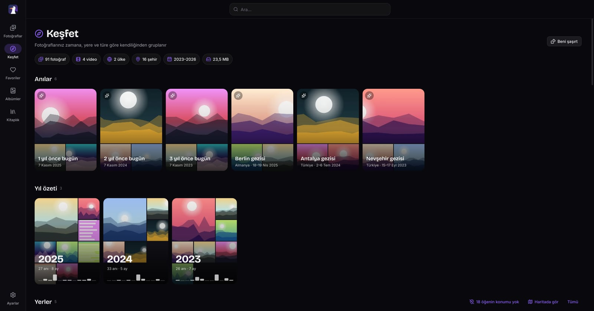
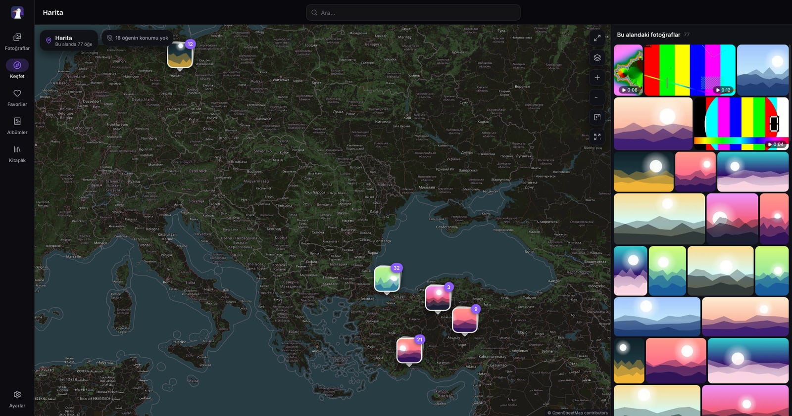

<p align="center">
  
</p>

<h1 align="center">PeekAround</h1>
<p align="center"><b>Your folders, beautifully.</b></p>

<p align="center"><b>English</b> · <a href="README-tr.md">Türkçe</a></p>

<p align="center">
  <a href="https://github.com/zearkreast/PeekAround/releases/latest"></a>
  <a href="https://github.com/zearkreast/PeekAround/releases"></a>
  <a href="LICENSE"></a>
  
</p>

<p align="center">
  <a href="https://github.com/zearkreast/PeekAround/releases/latest"><b>⬇️ Download</b></a> ·
  <a href="#features">Features</a> ·
  <a href="#installation">Installation</a> ·
  <a href="#development">Development</a>
</p>

<p align="center">
  
</p>

PeekAround turns the folders on your computer, server or phone into a modern, animated gallery. Browse and watch your photos and videos, sort them into albums, let it find your memories and trips, edit photos and videos, and make collages and slideshows. **It never touches the originals**: every edit is saved to a copy.

> 🦀 **2.0 is a rewrite in Rust + Slint.** No Electron, React or Node.js; the UI is drawn natively. The Windows installer went from 148 MB to 50 MB. Data from 1.x is read as it is. The old TypeScript version lives on the [`1.x`](https://github.com/zearkreast/PeekAround/tree/1.x) branch.

| | What it does | Package |
|---|---|---|
| 🖥️ **Desktop** | Personal gallery and editors; share it on your network if you like | Windows installer `.exe` and portable `.zip`, Linux `.tar.gz` |
| 📱 **Android** | Browse the phone's own folders **or** connect to a PeekAround server | `.apk` (64-bit ARM) |
| 🐳 **Docker** | A gallery on your home server or NAS, opened in the browser and in the Android app | `ghcr.io/zearkreast/peekaround` (amd64, arm64) |

---

## Features

**Gallery and viewer**
- Photos timeline: exact-layout grid, date headers, fast scroller; keyboard navigation, Ctrl+wheel for grid density
- Viewer: open/close animation, zoom to the cursor, filmstrip, info panel (date, camera, location, file path), mini map
- Video and audio are decoded with ffmpeg: every format plays and seeks; speed, loop, full screen, save a frame as a photo
- HEIC/AVIF open on the desktop (the Windows package ships libheif)

**Selection and organizing**
- Click, Ctrl, Shift, rectangle selection, Ctrl+A; selection bar and context menu: favorite, add to album, download as zip, move/copy, rename (F2), delete
- Drag photos onto an album or folder; files dropped from the computer are uploaded
- Library, albums, library page (statistics, cover, **All | Folders**), folder pages, exclusion rules
- Trash: on drives without a system trash (Docker, network shares) deleted files can be restored for 30 days

**Explore and map**
- Statistics, memories and trips, year in review, countries and cities, times of day, colors, formats, cameras, duplicates, calendar heatmap, "Surprise me"
- Story-style memory player, memory videos
- The app's own map: clustered thumbnails, a "photos in this area" panel, standard / topographic / satellite views, offline cache

<p align="center"></p>

**Editors (always save to a copy)**
- Photo: exposure, contrast, color, shadows/highlights, vignette, grain, sharpness, 13 presets (on the GPU, otherwise on the CPU with the same result); crop, aspect ratios, rotate, flip, straighten; text layers, emoji stickers, drawing; undo / redo, compare with the original
- Video: trim, crop, rotate, flip, color, timed text layers, speed, audio → MP4, WebM or GIF
- Collage: templates, aspect ratios, spacing/corners/background, pan and zoom inside a cell, text
- Slideshow: transitions and Ken Burns effect, music, drag to reorder; play it or export a video
- **Fonts:** bundled fonts with Turkish characters, upload your own TTF/OTF/WOFF fonts

**Phone**
- Native Android app: the photos on the phone or a PeekAround server on the network
- A layout made for phone screens, the back button, import with **Share → PeekAround**, share and save to Downloads
- Show phone folders on the computer (pairing with a 4-digit code); a background service with a notification, works with the screen off

**Other**
- MEGA streaming folders and MEGA account, upload and job panels
- Settings in sections, searchable in Turkish and English; settings backup
- Optional server password (`PEEK_PASSWORD`)
- Desktop: system tray, single window, start at login, notifications, taskbar progress, update check

---

## Installation

### 🖥️ Windows

1. Run `PeekAround-Setup-x.y.z.exe` from the [Releases](https://github.com/zearkreast/PeekAround/releases/latest) page. It installs for your user account only and does not ask for administrator rights. If you do not want to install, extract `PeekAround-x.y.z-win-x64.zip` to a folder and run `PeekAround.exe`.
2. The package is unsigned: on the "Windows protected your PC" warning choose "More info" → "Run anyway".
3. Your 1.x data (`%APPDATA%\PeekAround`) is read as it is: libraries, favorites, albums, MEGA folders, paired phones and preferences. **Do not run** 1.x and 2.x at the same time; they use the same database and port.

Log file: `%APPDATA%\PeekAround\logs\main.log`

### 🐧 Linux

Extract `PeekAround-x.y.z-linux-x64.tar.gz` and run `peekaround-desktop` inside it. `ffmpeg` and `libheif` (1.17 or newer) must be installed. The Linux package has not been tried on a real installation yet; if something goes wrong, please open an issue.

### 📱 Android

Download `PeekAround-x.y.z-android-arm64.apk` from Releases and install it (allow unknown sources). Android 7 and newer, 64-bit ARM phones only. It is signed with the same key as 1.3.x and installs as an update over it. On first launch choose:
- **Photos on this phone**: grant "All files access".
- **Connect to a PeekAround server**: servers on the network are found automatically, or type the address.

Audio output and video export are not available on the phone yet.

**To show a phone folder on the PC:** on the PC open Settings → Network and devices → turn on network sharing (port `1313`); on the phone open Settings → **Phone sharing** → pick the folders and turn it on. Compare the code in the window that appears on the PC with the one on the phone and choose **Allow**.

### 🐳 Docker

The server and the browser UI are in one image. The UI in the browser is the WebAssembly build of the same UI as the desktop app.

```bash
docker run -d --name peekaround -p 8080:8080 -e PUID=1000 -e PGID=1000 -v /path/Photos:/media/Photos -v ./peekaround-data:/data ghcr.io/zearkreast/peekaround:latest
```

or edit the folder paths in `docker/docker-compose.yml` and run `docker compose -f docker/docker-compose.yml up -d`. Every folder you mount under `/media` becomes a library. Open `http://<server-ip>:8080` in the browser; the Android app connects to the same address.

- **Moving from 1.x:** changing the image tag is enough. The `/data` folder (libraries, favorites, albums, thumbnails) and the environment variables stay the same. Back up `/data` first if you like; to go back to 1.x use the `ghcr.io/zearkreast/peekaround:1.3.2` tag.
- **Browser:** a current browser with WebAssembly and WebGL is required. The first visit downloads 6 to 9 MB.
- **Differences in the browser:** downloads go to the browser's download folder; to upload, pick files or drag them onto the page. Video and audio play in the browser's own player; formats the browser cannot open (MKV, HEVC, AVI) are converted by the server. The photo editor runs on the CPU instead of the GPU. Most emoji stickers do not show in the browser (the browser build has no emoji font).
- **Tags:** `latest` is the latest release, a version number like `2.6.0`, and `main` is the latest state of the development branch (amd64 only).

| Variable | Default | Description |
|---|---|---|
| `PEEK_ROOTS` | `/media` | Folders that become libraries on first start; `Name=/path`, comma-separated |
| `PEEK_SPLIT_ROOTS` | `true` | Every subfolder of a root becomes its own library |
| `PUID` / `PGID` | `0` | Owner of written files (`id -u` / `id -g`) |
| `PEEK_WATCH_POLL` | `false` | Watches for file changes by polling, for network shares (NFS/SMB) |
| `PEEK_READONLY` | `false` | Turns off writing to files and settings: upload, edit, delete, zip extraction, fonts, settings (favorites and albums stay available) |
| `PEEK_BROWSE_ROOTS` | `/media` | Directories the "Add folder" browser may show |
| `PEEK_PORT` | `8080` | Port |
| `TZ` | none | Time zone (for example `Europe/Istanbul`); becomes the "home time zone" on first start |
| `PEEK_PASSWORD` | none | When set, the browser and the apps ask to sign in; paired phones connect with their own key |
| `PEEK_ALLOWED_HOSTS` | none | If you use a domain name (for example `photos.example.com` behind a reverse proxy), add it here, comma-separated; `*` turns the check off |
| `PEEK_ALLOWED_ORIGINS` | none | Extra browser origins allowed to call the API |
| `PEEK_TRUSTED_PROXIES` | none | IP addresses of your reverse proxy (for example `127.0.0.1`); for requests from them the client address is read from `X-Forwarded-For`, so the rate limit applies per client |

> Without `PEEK_PASSWORD` there is no authentication: run PeekAround only on networks you trust, or put an encrypting reverse proxy in front of it. The password is a single shared password; still use HTTPS when you expose it to the internet.
> Browser-based attacks are blocked: unknown host names (DNS rebinding), write requests from other sites (CSRF) and excessive requests are refused. `.local`, `.lan`, IP addresses and single-word host names (for example `nas`) always work.

To build the image yourself use `docker build -f docker/Dockerfile -t peekaround .`. Building the UI needs a lot of memory: with 8 GB given to Docker the build ran out. The ready-made image is easier.

---

## Development

Requirements: current stable Rust, ffmpeg (on the PATH). On Linux also the development packages of `libheif` (1.17+), `libasound2`, `libfontconfig1` and `libxkbcommon`.

```bash
cargo build --release -p pa-desktop      # desktop app
cargo build --release -p pa-cli          # headless server
sh crates/pa-web/build.sh web            # browser UI (needs the wasm32-unknown-unknown target)
cargo test --workspace
```

To try the server with the browser UI: `peekaround -r /path/Photos --web web`.

To try the UI without a server: `pa-desktop --demo 10000` (a fake library of 10,000 items). For screenshots and automation use the `PA_SCRIPT` environment variable (`wait 2000; nav explore; shot a.png; quit`); `PA_PHONE=1` turns on the phone layout.

Packages are built with GitHub Actions: a tag like `v2.6.0` builds the Windows, Linux and Android packages and attaches them to a Release, and pushes the Docker image to `ghcr.io`. Details: [docs/github-actions.md](docs/github-actions.md).

### Layout

```
crates/pa-core     Pure logic and API types
crates/pa-server   HTTP/WebSocket server: axum + tokio + SQLite
crates/pa-cli      peekaround: headless server (the program in the Docker image)
crates/pa-web      Browser UI: WebAssembly build of pa-ui, served by the Docker server
crates/pa-desktop  Desktop app: Slint UI + embedded server, tray, notifications
crates/pa-android  Android app: the same UI on NativeActivity + embedded server
crates/pa-ui       Slint UI: every screen, the editors and the view models
crates/pa-client   Typed API client (HTTP + live events)
crates/pa-media    Image decoding/resizing, thumbhash, ffmpeg wrapper
crates/pa-meta     EXIF / XMP, Google Takeout, video tags
crates/pa-jobs     Job queue: video editing, slideshow export, live transcoding
crates/pa-mega     MEGA client: links, encrypted chunked download, account session
crates/pa-remote   MEGA streaming folders: listing, thumbnails, cache, quota
crates/pa-link     Phone link (computer side): pairing, device folders, transfers
crates/pa-phone    Phone link (phone side)
assets/geo         Offline place names (GeoNames)
docker/            Dockerfile and compose file
third_party/       Patched copy of the Slint winit backend (0 Hz display fix)
```

Technical plan: [`docs/rust/PLAN.md`](docs/rust/PLAN.md)

## Attributions

- Place names: [GeoNames](https://www.geonames.org/) (CC BY 4.0) — `assets/geo/ATTRIBUTION.txt`
- Map: © [OpenStreetMap](https://www.openstreetmap.org/copyright) contributors; topographic: © [OpenTopoMap](https://opentopomap.org) (CC-BY-SA); satellite: © Esri, Maxar, Earthstar Geographics
- UI fonts Inter and Bricolage Grotesque (SIL OFL), icons Lucide (ISC)
- ffmpeg in the Android package: LGPL 2.1

## License

GNU GPL v3 — see the `LICENSE` file. The bundled fonts are distributed under the SIL Open Font License.
