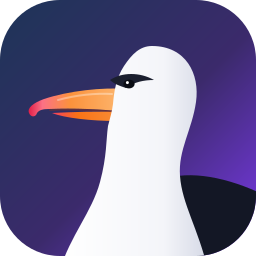

<p align="center">
  
</p>

<h1 align="center">PeekAround</h1>
<p align="center"><b>Klasörlerin, en güzel haliyle.</b> · <i>Your folders, beautifully.</i></p>

PeekAround; bilgisayarındaki, sunucundaki ya da telefonundaki klasörleri modern, animasyonlu bir galeriye dönüştürür.
Fotoğraf ve videolarına göz at, izle, sürükle-bırak ile dosya/klasör/zip ekle, slayt gösterisi ve kolaj yap, fotoğraf ve videolarda basit düzenlemeler yap — **kendi fontlarınla** ve **orijinallere asla dokunmadan** (her düzenleme bir kopyaya kaydedilir).

Aynı uygulama üç şekilde çalışır:

| | Ne işe yarar | Paket |
|---|---|---|
| 🐳 **Docker / sunucu** | Ev sunucuna/NAS'a kur, galeriyi tüm ağa sun (tarayıcıdan, telefondan) | `docker compose up -d` |
| 🖥️ **Masaüstü uygulaması** | Kişisel galeri; istersen tek tıkla ağda paylaş | Windows `.exe`, Arch Linux `.pacman` / PKGBUILD, AppImage, `.deb` |
| 📱 **Android** | Telefonun kendi klasörlerini gez **veya** bir PeekAround sunucusuna bağlan | `.apk` |

---

## Özellikler

**Galeri**
- Kütüphane = bir veya birden çok klasör; **Tümü | Klasörler** görünümü, istatistikler (boyut, tarih aralığı, son tarama), kapak fotoğrafı, yeniden tarama, **hariç tutma kuralları** (klasör adı/glob, en küçük boyut, gizli klasörler)
- **Albümler:** kütüphanelerden bağımsız, elle oluşturulan koleksiyonlar (sürükle-bırak, özel sıralama, kapak, zip indir)
- Açılışta **Fotoğraflar** (zaman çizelgesi + anılar), **Kitaplık** sayfasında albümler, kütüphaneler, cihazlar ve araçlar bir arada
- Kesin yerleşimli *justified* ızgara: 100 bin dosyada bile kayma/zıplama yok; Google Fotoğraflar tarzı **tarih kaydırıcısı** ile istediğin aya anında atla
- Telefonda **iki parmakla ızgara yoğunluğu**, uzun basıp sürükleyerek çoklu seçim, alt menü (Fotoğraflar / Keşfet / Kitaplık / Ayarlar), Android geri tuşu desteği
- Küçük resimden tam ekrana **paylaşılan öğe geçişi**; görüntüleyicide parmağı takip eden kaydırma, odak noktalı pinch-zoom, çift dokunma, aşağı kaydırıp kapatma, yukarı kaydırıp bilgi; EXIF + konum + kamera bilgisi
- Video: özel oynatıcı (önizlemeli zaman çubuğu, hız, döngü, PiP, kareyi fotoğraf olarak kaydet); tarayıcının oynatamadığı formatlar (MKV/HEVC/AVI…) sunucuda anlık dönüştürülür
- Videoların üzerine gelince sessiz önizleme, thumbhash ile anında bulanık yer tutucu
- Seçim: tık, Shift-aralık, Ctrl, **kement (dikdörtgen sürükleme)**; toplu favori/indir/taşı/kopyala/sil
- Diskteki değişiklikler **canlı** yansır (dosya izleme + WebSocket)

**Keşfet — otomatik gruplama (Google Fotoğraflar gibi)**
- **Anılar:** “Geçmişte bugün” ve otomatik bulunan **geziler** (“Antalya gezisi · Tem 2024”), hikâye tarzı anı oynatıcı
- **Yerler + harita:** GPS’ten çevrimdışı yer adı (“Kadıköy, İstanbul”), ülke → bölge → şehir, küçük resimli kümelerle harita (standart / topoğrafik / uydu). Harita karoları sunucu üzerinden çekilip önbelleğe alınır; bakılan bölgeler çevrimdışı da görünür
- Konum EXIF’in yanında **XMP**’den ve **Google Takeout** `.json` dosyalarından da okunur; Ayarlar → “Konum ve meta veri” kartı hangi dosyalarda konum olmadığını gösterir
- **Daha fazla Keşfet:** yıl özeti, gece çekimleri ve altın saat, renkler, dikey/yatay/panorama, kısa klipler/uzun videolar, en büyük dosyalar, son eklenenler, **kopyalar**, takvim ısı haritası, “Beni şaşırt”
- **Türler + kameralar:** videolar, ekran görüntüleri, selfie’ler, panoramalar, animasyonlar; telefon/kamera modeline göre; yıllar
- Doğal dille arama: “istanbul 2023 video”, “Ağustos 2024”, “selfie”
- Tarihler fotoğrafın çekildiği yerin saatine göre gruplanır (Ayarlar → Keşfet’ten ev saat dilimi)

**Telefon ↔ PC**
- Masaüstü uygulaması ağda paylaşırken telefon bağlanınca, **telefonda seçtiğin klasörler PC’de görünür** (ilk bağlantıda PC’de 4 haneli kodla onay)
- PC’den telefon klasörünü gez, izle, **PC’ye kopyala**; PC’deki dosyaları **telefona gönder** (telefondaki dosyalar PC’den silinemez/değiştirilemez)
- Telefonda **Yükle** → PC’ye; **Telefona kaydet** → her seferinde klasör sorulur, dosyalar kalıcı kaydedilir ve galeride görünür; tarih ve konum bilgisi korunur
- Telefon ekranı kapalıyken de çalışır (bildirimli arka plan servisi, “Durdur” düğmesi)

**Ekleme**
- Uygulamanın üzerine **dosya, klasör veya zip sürükle-bırak** (kenar çubuğundaki/kart üzerindeki klasöre bırakma da olur)
- Zip için istem: **Kalıcı olarak çıkar** veya **Geçici olarak aç** + **“Seçimimi hatırla”** kutucuğu (Ayarlar’dan değiştirilebilir). Geçici oturumlar kendiliğinden silinir, istersen “Kalıcı yap”.
- Kütüphanedeki zip’lere “Göz at” ile geçici bakma; Türkçe Windows zip’lerindeki (CP857) dosya adları doğru çözülür
- Masaüstünde bırakılan klasör: **kütüphaneye bağla** (kopyalamadan) veya **buraya kopyala**
- Android’de **Paylaş → PeekAround**
- **MEGA linkleri:** mega.nz dosya/klasör linkini yapıştır, sürükle ya da MEGA uygulamasından paylaş → **indirmeden izle** (link kütüphane klasörü olur; fotoğraflar/videolar MEGA’dan akışla açılır, sadece küçük resimler ve sınırlı bir önbellek diske yazılır) veya seçip bilgisayara kopyala. MEGA aktarım kotası dolarsa Ayarlar → Ağ → **MEGA hesabı** ile giriş yapılabilir: aktarımlar IP’nin ortak kotası yerine hesabın kotasından düşer (Pro’da çok daha büyük)

**Düzenleme (her zaman kopyaya: `ad_edit.jpg`, `ad_edit-2.jpg` …)**
- Fotoğraf editörü: pozlama, kontrast, sıcaklık, gölge/vurgu, vinyet, gren… (WebGL), filtre ön ayarları, kırp/döndür/çevir/düzleştir, **özel fontlu metin katmanları**, geri/ileri al, önce/sonra
- Kolaj: şablonlar, oranlar (1:1, 4:5, 9:16…), boşluk/köşe/arka plan, hücre içi kaydırma/yakınlaştırma, metin
- Video editörü: kırpma (trim), crop, döndür/çevir, hız, ses, renk ayarları, zamanlı metin katmanları → MP4/WebM/GIF
- Slayt gösterisi: tarayıcıda animasyonlu geçişlerle oynat **veya** müzikli MP4 olarak dışa aktar (Ken Burns, geçiş efektleri)
- **Fontlar**: TTF/OTF/WOFF/WOFF2 yükle; tüm editörlerde canlı önizlemeli font seçici; Türkçe karakterli hazır fontlar

**Diğer**
- Türkçe / İngilizce arayüz, koyu/açık tema, vurgu rengi, animasyon seviyesi (tam/azaltılmış/kapalı), sayfa geçişleri
- Aranabilir, bölümlere ayrılmış **Ayarlar** (ızgara, görüntüleyici, video, önbellek, performans, gizlilik, klavye kısayolları, ayar yedeği); `?` ile kısayol listesi
- Masaüstü: sistem tepsisi, oturum açılışında başlat, güncelleme denetimi, bildirimler, görev çubuğunda ilerleme, dosyaları pencereden dışarı sürükleme
- PWA: telefondan “Ana ekrana ekle”
- Ağdaki sunucular mDNS ile otomatik bulunur (Android uygulaması), ayarlarda bağlantı adresi + QR kod

---

## Kurulum

### 🐳 Docker (ağa galeri sunmak için)

```bash
git clone https://github.com/<kullanici>/peekaround.git
cd peekaround
```

`docker/docker-compose.yml` içindeki klasör yollarını kendine göre düzenle (her `/media/<Ad>` bir kütüphane olur), sonra:

```bash
docker compose -f docker/docker-compose.yml up -d --build
```

Tarayıcıdan `http://<sunucu-ip>:8080` adresine git.

Hazır imaj (GitHub Actions ile `ghcr.io`'ya gönderilir, amd64 + arm64/Raspberry Pi):

```bash
docker run -d --name peekaround -p 8080:8080 -e PUID=1000 -e PGID=1000 -v /yol/Fotoğraflar:/media/Fotoğraflar -v ./peekaround-data:/data ghcr.io/<kullanici>/peekaround:latest
```

| Değişken | Varsayılan | Açıklama |
|---|---|---|
| `PEEK_ROOTS` | `/media` | İlk açılışta kütüphane yapılacak klasör(ler); `Ad=/yol` biçimi, virgülle ayrılır |
| `PEEK_SPLIT_ROOTS` | `true` | Kökün her alt klasörü ayrı kütüphane olsun |
| `PUID` / `PGID` | `0` | Yazılan dosyaların sahibi (`id -u` / `id -g`) |
| `PEEK_WATCH_POLL` | `false` | Ağ paylaşımlarında (NFS/SMB) dosya değişikliklerini yoklayarak izle |
| `PEEK_READONLY` | `false` | Yükleme/düzenleme/silmeyi kapat |
| `PEEK_BROWSE_ROOTS` | `/media` | “Klasör ekle” gezgininin gösterebileceği dizinler |
| `PEEK_PORT` | `8080` | Port |
| `TZ` | – | Saat dilimi (ör. `Europe/Istanbul`); ilk açılışta “ev saat dilimi” olur |
| `PEEK_ALLOWED_HOSTS` | – | Alan adıyla erişiyorsan (ör. ters vekil arkasında `foto.ornek.com`) virgülle ekle; `*` kontrolü kapatır |
| `PEEK_ALLOWED_ORIGINS` | – | API’yi çağırabilecek ek tarayıcı kökenleri |

> Kimlik doğrulama yoktur: PeekAround’u yalnızca güvendiğin ağlarda çalıştır ya da önüne bir ters vekil (reverse proxy) + şifre koy.
> Yine de tarayıcı tabanlı saldırılara karşı korunur: bilinmeyen alan adları (DNS rebinding), başka sitelerden gelen yazma istekleri (CSRF) ve aşırı istekler (hız sınırı) reddedilir. `.local`, `.lan`, IP adresleri ve tek kelimelik ağ adları (ör. `nas`) her zaman çalışır.
>
> **MEGA hesabı (isteğe bağlı, Ayarlar → Ağ):** şifre hiçbir yere kaydedilmez; sunucu yalnızca MEGA oturum kimliğini (`sid`) veritabanında (`peekaround.db`, `settings` tablosu, `megaSession`) tutar ve bunu hiçbir istemciye göndermez. Masaüstü uygulamasında giriş/çıkış yalnızca bilgisayarın kendisinden yapılabilir (yerel ağ paylaşımından gelen istekler 403 alır). **Sunucu/Docker modunda** bu ayrım yoktur: sunucuya erişebilen herkes hesaba giriş/çıkış yapabilir ve MEGA aktarımları o hesabın kotasından düşer. Veritabanı dosyası ve yedekleri oturum kimliğini içerir; “Çıkış yap” onu siler ve oturumu MEGA tarafında da sonlandırır.

### 🖥️ Masaüstü

- **Windows:** Releases’tan `PeekAround-Setup-x.y.z.exe` (kurulum) veya `PeekAround-x.y.z-portable.exe`
- **Arch Linux:** `sudo pacman -U PeekAround-x.y.z-x64.pacman` ya da `packaging/arch/PKGBUILD` ile `makepkg -si`
- **Diğer Linux:** `PeekAround-x.y.z-x86_64.AppImage` (çalıştırılabilir yap ve aç) veya `.deb`

İlk açılışta Resimler ve Videolar klasörlerin kütüphane olarak eklenir. Ayarlar → Ağ’dan **“Galeriyi yerel ağda paylaş”** ile aynı uygulama ağdaki diğer cihazlara da galeri sunar.

### 📱 Android

Releases’tan `PeekAround-*.apk` indir ve yükle (bilinmeyen kaynaklara izin ver). İlk açılışta seç:
- **Bu telefondaki fotoğraflar** — “Tüm dosyalara erişim” iznini ver; Kamera/Resimler/Filmler/İndirilenler/WhatsApp kütüphane olarak eklenir. Düzenlemeler, videolar ve slaytlar telefonda (Media3, donanım kodlayıcı) işlenir.
- **Bir PeekAround sunucusuna bağlan** — ağdaki sunucular otomatik bulunur ya da adresi yaz.

Bağlantıyı daha sonra Ayarlar → Bağlantı’dan değiştirebilirsin.

**Telefon klasörünü PC’de göstermek için:** PC’de Ayarlar → Ağ → “Galeriyi yerel ağda paylaş”ı aç; telefonda Ayarlar → **Telefon paylaşımı** → klasörleri seç ve aç. PC’de çıkan penceredeki kodu telefondakiyle karşılaştırıp **İzin ver** de. İzinler: medya, konum (fotoğrafların konum bilgisi korunsun diye) ve bildirim.

---

## Geliştirme

Gereksinimler: Node.js ≥ 22.13 (24 önerilir), ffmpeg (PATH’te; ffprobe varsa kullanılır, yoksa gerekmez).

```bash
npm install
npm run fixtures      # örnek medya: fixtures/library
npm run dev           # API :8787 + arayüz :5173 (http://localhost:5173)
```

```bash
npm run typecheck
npm test
npm run build                       # web + sunucu
node packages/server/dist/cli.js --root ~/Resimler   # tek komutla sunucu
```

Masaüstü:

```bash
npm run build -w @peekaround/web
node packages/desktop/scripts/stage.mjs                 # stage/ klasörü
npx electron packages/desktop/stage                    # çalıştır
node packages/desktop/scripts/dist.mjs --linux          # AppImage + pacman + deb (bsdtar gerekir)
node packages/desktop/scripts/stage.mjs --platform=win32 --arch=x64 && node packages/desktop/scripts/dist.mjs --win
```

Android (JDK 21 + Android SDK, `ANDROID_HOME` ayarlı):

```bash
npm run build -w @peekaround/web
cd packages/android && npx cap sync android && cd android && ./gradlew assembleDebug
```

İkonlar `brand/logo.svg`’den üretilir: `node scripts/make-icons.mjs`

### Yapı

```
packages/shared    Ortak TypeScript API sözleşmesi
packages/server    Fastify 5 sunucu (Docker + masaüstü içinde aynı kod): tarama, izleme, küçük resim (sharp), ffmpeg işleri, zip, fontlar
packages/web       React 19 + Vite + Tailwind 4 + Motion arayüz (tüm platformlar)
packages/desktop   Electron kabuğu (gömülü sunucu, yerel klasör seçici, ağda paylaş)
packages/android   Capacitor 8 + Kotlin eklentisi (yerel medya sunucusu, Media3, mDNS, paylaşım)
docker/            Dockerfile + compose
brand/             Logo (albatros)
```

### GitHub’a gönderince

`.github/workflows/build.yml`:

- **Her push ve pull request:** tip kontrolü ve testler.
- **`v1.3.0` gibi bir etiket:** Windows/Linux paketleri, Android APK ve Docker imajı derlenip hepsi bir **Release**’e eklenir.

```bash
git tag v1.3.0
git push origin v1.3.0
```

Kişisel token gerekmez; otomatik `GITHUB_TOKEN` yeterli. Push için token, imzalı APK secret’ları ve sorun giderme: [docs/github-actions.md](docs/github-actions.md).

## Atıflar

- Yer adları: [GeoNames](https://www.geonames.org/) (CC BY 4.0) — `packages/web/public/geo/ATTRIBUTION.txt`
- Harita: © [OpenStreetMap](https://www.openstreetmap.org/copyright) katkıcıları (Leaflet, supercluster); topoğrafik: © [OpenTopoMap](https://opentopomap.org) (CC-BY-SA); uydu: © Esri, Maxar, Earthstar Geographics

## Lisans

GNU GPL v3 — ayrıntılar `LICENSE` dosyasında. Hazır fontlar SIL Open Font License ile dağıtılır (@fontsource).
