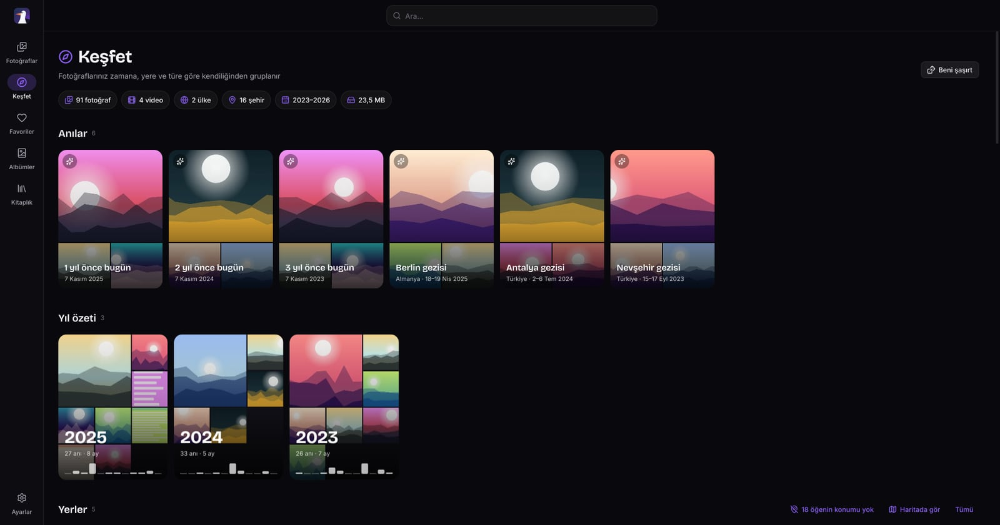
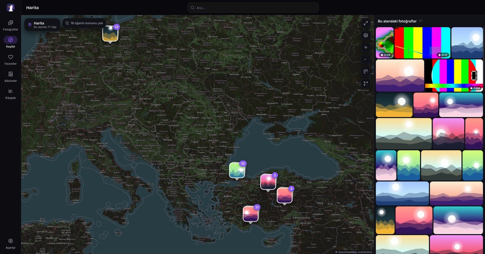

<p align="center">
  
</p>

<h1 align="center">PeekAround</h1>
<p align="center"><b>Klasörlerin, en güzel haliyle.</b> · <i>Your folders, beautifully.</i></p>

<p align="center">
  <a href="https://github.com/zearkreast/PeekAround/releases/latest"></a>
  <a href="https://github.com/zearkreast/PeekAround/releases"></a>
  <a href="LICENSE"></a>
  
</p>

<p align="center">
  <a href="https://github.com/zearkreast/PeekAround/releases/latest"><b>⬇️ İndir</b></a> ·
  <a href="#özellikler">Özellikler</a> ·
  <a href="#kurulum">Kurulum</a> ·
  <a href="#geliştirme">Geliştirme</a>
</p>

<p align="center">
  
</p>

PeekAround; bilgisayarındaki, sunucundaki ya da telefonundaki klasörleri modern, animasyonlu bir galeriye dönüştürür. Fotoğraf ve videolarına göz at, izle, albümlere ayır, anılarını ve gezilerini otomatik bulsun, fotoğraf ve videolarda düzenleme yap, kolaj ve slayt gösterisi hazırla. **Orijinallere hiç dokunmaz**: her düzenleme bir kopyaya kaydedilir.

> 🦀 **2.0, Rust + Slint ile baştan yazıldı.** Electron, React ve Node.js yok; arayüz yerel olarak çizilir. Windows paketi 148 MB'tan yaklaşık 40 MB'a indi. 1.x'teki veriler olduğu gibi okunur. Eski TypeScript sürümü [`1.x`](https://github.com/zearkreast/PeekAround/tree/1.x) dalında.

| | Ne işe yarar | Paket |
|---|---|---|
| 🖥️ **Masaüstü** | Kişisel galeri ve düzenleyiciler; istersen ağda paylaş | Windows kurulum `.exe` ve taşınabilir `.zip`, Linux `.tar.gz` |
| 📱 **Android** | Telefonun kendi klasörlerini gez **veya** bir PeekAround sunucusuna bağlan | `.apk` (64 bit ARM) |
| 🐳 **Docker** | Ev sunucusunda tarayıcıdan galeri | Şimdilik **1.3.2** imajı, aşağıya bak |

---

## Özellikler

**Galeri ve görüntüleyici**
- Fotoğraflar zaman çizelgesi: kesin yerleşimli ızgara, tarih başlıkları, hızlı kaydırıcı; klavyeyle gezinme, Ctrl+tekerlek ile ızgara yoğunluğu
- Görüntüleyici: açılış/kapanış animasyonu, imlece göre yakınlaştırma, film şeridi, bilgi paneli (tarih, kamera, konum, dosya yolu), mini harita
- Video ve ses ffmpeg ile çözülür: her format oynar ve sarılabilir; hız, döngü, tam ekran, kareyi fotoğraf olarak kaydetme
- HEIC/AVIF masaüstünde açılır (Windows paketinde libheif hazır gelir)

**Seçim ve düzen**
- Tık, Ctrl, Shift, dikdörtgen seçim, Ctrl+A; seçim çubuğu ve sağ tık menüsü: favori, albüme ekle, zip indir, taşı/kopyala, yeniden adlandır (F2), sil
- Fotoğrafları albüme veya klasöre sürükle; bilgisayardan bırakılan dosyalar yüklenir
- Kitaplık, albümler, kütüphane sayfası (istatistikler, kapak, **Tümü | Klasörler**), klasör sayfaları, hariç tutma kuralları

**Keşfet ve harita**
- İstatistikler, anılar ve geziler, yıl özeti, ülkeler ve şehirler, günün saatleri, renkler, biçimler, kameralar, kopyalar, takvim ısı haritası, "Beni şaşırt"
- Hikâye tarzı anı oynatıcı, anı videoları
- Uygulamanın kendi haritası: kümelenmiş küçük resimler, "bu alandaki fotoğraflar" paneli, standart / topoğrafik / uydu görünümü, çevrimdışı önbellek

<p align="center"></p>

**Düzenleyiciler (her zaman kopyaya kaydeder)**
- Fotoğraf: pozlama, kontrast, renk, gölge/vurgu, vinyet, gren, keskinlik, 13 hazır filtre (ekran kartında, yoksa işlemcide aynı sonuçla); kırpma, oranlar, döndürme, çevirme, düzeltme; metin katmanları, emoji çıkartmalar, çizim; geri al / yinele, orijinalle karşılaştırma
- Video: kırpma, kadrajlama, döndürme, çevirme, renk, zamanlı metin katmanları, hız, ses → MP4, WebM veya GIF
- Kolaj: şablonlar, oranlar, boşluk/köşe/arka plan, hücre içinde kaydırma ve yakınlaştırma, metin
- Slayt gösterisi: geçişler ve Ken Burns efekti, müzik, sürükleyerek sıralama; oynat veya video olarak dışa aktar
- **Fontlar:** hazır Türkçe karakterli fontlar, kendi TTF/OTF/WOFF fontlarını yükleme

**Telefon**
- Yerel Android uygulaması: telefondaki fotoğraflar ya da ağdaki bir PeekAround sunucusu
- Telefon ekranına uygun düzen, geri tuşu, **Paylaş → PeekAround** ile içeri alma, paylaşma ve İndirilenler klasörüne kaydetme
- Telefon klasörlerini bilgisayarda gösterme (4 haneli kodla eşleştirme); bildirimli arka plan servisi, ekran kapalıyken de çalışır

**Diğer**
- MEGA akış klasörleri ve MEGA hesabı, yükleme ve iş panelleri
- Bölümlere ayrılmış, Türkçe ve İngilizce aranabilir ayarlar; ayar yedeği
- Masaüstü: sistem tepsisi, tek pencere, oturum açılışında başlatma, bildirimler, görev çubuğunda ilerleme, güncelleme denetimi

---

## Kurulum

### 🖥️ Windows

1. [Releases](https://github.com/zearkreast/PeekAround/releases/latest) sayfasından `PeekAround-Setup-x.y.z.exe` dosyasını çalıştır. Kurulum yalnızca senin kullanıcı hesabına yapılır, yönetici izni istemez. Kurulum istemiyorsan `PeekAround-x.y.z-win-x64.zip` dosyasını bir klasöre çıkarıp `PeekAround.exe` dosyasını çalıştır.
2. Paket imzasız: "Windows bilgisayarınızı korudu" uyarısında "Ek bilgi" → "Yine de çalıştır".
3. 1.x'teki verilerin (`%APPDATA%\PeekAround`) olduğu gibi okunur: kütüphaneler, favoriler, albümler, MEGA klasörleri, eşleşmiş telefonlar ve tercihler. 1.x ile 2.0'ı **aynı anda açma**; aynı veritabanını ve portu kullanırlar.

Günlük dosyası: `%APPDATA%\PeekAround\logs\main.log`

### 🐧 Linux

`PeekAround-x.y.z-linux-x64.tar.gz` dosyasını çıkar ve içindeki `peekaround-desktop` dosyasını çalıştır. Sistemde `ffmpeg` ve `libheif` (1.17 veya üstü) kurulu olmalı. Linux paketi henüz gerçek bir kurulumda denenmedi; sorun görürsen bir issue aç.

### 📱 Android

Releases'tan `PeekAround-x.y.z-android-arm64.apk` indir ve yükle (bilinmeyen kaynaklara izin ver). Android 7 ve üstü, yalnızca 64 bit ARM telefonlar. 1.3.x ile aynı anahtarla imzalı, onun üzerine güncelleme olarak kurulur. İlk açılışta seç:
- **Bu telefondaki fotoğraflar**: "Tüm dosyalara erişim" iznini ver.
- **Bir PeekAround sunucusuna bağlan**: ağdaki sunucular otomatik bulunur ya da adresi yaz.

Telefonda ses çıkışı ve video dışa aktarma henüz yok.

**Telefon klasörünü PC'de göstermek için:** PC'de Ayarlar → Ağ ve cihazlar → ağ paylaşımını aç (port `1313`); telefonda Ayarlar → **Telefon paylaşımı** → klasörleri seç ve aç. PC'de çıkan penceredeki kodu telefondakiyle karşılaştırıp **İzin ver** de.

### 🐳 Docker

2.0'ın tarayıcı arayüzü sonraki sürümde gelecek. O zamana kadar Docker için **1.3.2** imajı kullanılır:

```bash
docker run -d --name peekaround -p 8080:8080 -e PUID=1000 -e PGID=1000 -v /yol/Fotoğraflar:/media/Fotoğraflar -v ./peekaround-data:/data ghcr.io/zearkreast/peekaround:1.3.2
```

ya da `docker/docker-compose.yml` içindeki klasör yollarını düzenleyip `docker compose -f docker/docker-compose.yml up -d`. Tarayıcıdan `http://<sunucu-ip>:8080` adresine git. Ortam değişkenleri ve güvenlik notları [`1.x` dalının README'sinde](https://github.com/zearkreast/PeekAround/tree/1.x#-docker-ağa-galeri-sunmak-için).

---

## Geliştirme

Gereksinimler: güncel kararlı Rust, ffmpeg (PATH'te). Linux'ta ayrıca `libheif` (1.17+), `libasound2`, `libfontconfig1` ve `libxkbcommon` geliştirme paketleri.

```bash
cargo build --release -p pa-desktop      # masaüstü uygulaması
cargo build --release -p pa-cli          # başsız sunucu
cargo test --workspace
```

Sunucu olmadan arayüzü denemek için: `pa-desktop --demo 10000` (10 bin öğelik sahte kütüphane). Ekran görüntüsü ve otomasyon için `PA_SCRIPT` ortam değişkeni (`wait 2000; nav explore; shot a.png; quit`); `PA_PHONE=1` telefon düzenini açar.

Paketler GitHub Actions ile derlenir: `v2.0.0` gibi bir etiket Windows, Linux ve Android paketlerini derleyip Release'e ekler. Ayrıntılar: [docs/github-actions.md](docs/github-actions.md).

### Yapı

```
crates/pa-core     Saf mantık ve API tipleri
crates/pa-server   HTTP/WebSocket sunucu: axum + tokio + SQLite
crates/pa-cli      peekaround: başsız sunucu
crates/pa-desktop  Masaüstü uygulaması: Slint arayüz + gömülü sunucu, tepsi, bildirimler
crates/pa-android  Android uygulaması: NativeActivity üzerinde aynı arayüz + gömülü sunucu
crates/pa-ui       Slint arayüzü: tüm ekranlar, düzenleyiciler ve görünüm modelleri
crates/pa-client   Tipli API istemcisi (HTTP + canlı olaylar)
crates/pa-media    Resim çözme/küçültme, thumbhash, ffmpeg sarmalayıcı
crates/pa-meta     EXIF / XMP, Google Takeout, video etiketleri
crates/pa-jobs     İş kuyruğu: video düzenleme, slayt dışa aktarma, canlı dönüştürme
crates/pa-mega     MEGA istemcisi: bağlantılar, şifreli parçalı indirme, hesap oturumu
crates/pa-remote   MEGA akış klasörleri: listeleme, küçük resim, önbellek, kota
crates/pa-link     Telefon bağlantısı (bilgisayar tarafı): eşleştirme, cihaz klasörleri, aktarımlar
crates/pa-phone    Telefon bağlantısı (telefon tarafı)
assets/geo         Çevrimdışı yer adları (GeoNames)
third_party/       Slint winit arka ucunun yamalı kopyası (0 Hz ekran düzeltmesi)
```

Teknik plan: [`docs/rust/PLAN.md`](docs/rust/PLAN.md)

## Atıflar

- Yer adları: [GeoNames](https://www.geonames.org/) (CC BY 4.0) — `assets/geo/ATTRIBUTION.txt`
- Harita: © [OpenStreetMap](https://www.openstreetmap.org/copyright) katkıcıları; topoğrafik: © [OpenTopoMap](https://opentopomap.org) (CC-BY-SA); uydu: © Esri, Maxar, Earthstar Geographics
- Arayüz fontları Inter ve Bricolage Grotesque (SIL OFL), simgeler Lucide (ISC)
- Android paketindeki ffmpeg: LGPL 2.1

## Lisans

GNU GPL v3 — ayrıntılar `LICENSE` dosyasında. Hazır fontlar SIL Open Font License ile dağıtılır.
